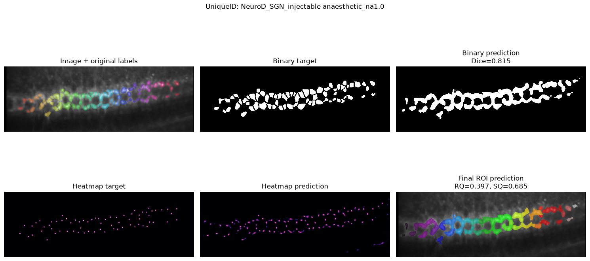

# Cochlea Synapse ROI Segmentation U-Net 2D
[](TODO)


Small MONAI/PyTorch pipeline for 2D cochlear microscopy ROI segmentation. This pipeline trains an UNET model for the segmentation of fluorescently-labelled putative cochlear boutons. 

The ROI inference uses two U-Net models:

- a binary foreground model
- a center heatmap model whose peaks are used as watershed markers

Input: single-channel `*_Avg.tif` image.  
Output: instance-label ROI mask. Optional intermediate outputs are the binary foreground mask, center heatmap, and marker image.




## Files

```text
config/                                 # training configs for the binary and heatmap models
config/binary_model_v5_synaptic.yml
config/heatmap_model_v5_synaptic.yml
scripts/train_binary.py                 # binary foreground model training
scripts/train_heatmap.py                # center heatmap model training
scripts/combine_roi_model_weights.py    # combine the weights of the two model into a single file
infer_rois.py                           # single-image ROI inference
src/                                    # data, model, transforms, train/validate helpers
binary_check_predictions.ipynb          # notebook to check predictions of the binary model.
heatmap_check_predictions.ipynb         # notebook to check predictions of the heatmap model.
binary_heatmap_check_predictions.ipynb  # notebook to check predictions of the two models and final watershed-based roi segmentation.
```

## Train

Training requires a config file. Epochs, workers, checkpoint paths, model settings, augmentation flags/probabilities, split settings, and data paths are read from YAML.

Train the binary foreground model:

```bash
.venv/bin/python scripts/train_binary.py config/binary_model_v5_synaptic.yml
```

Train the center heatmap model:

```bash
.venv/bin/python scripts/train_heatmap.py config/heatmap_model_v5_synaptic.yml
```

If the configured checkpoint path exists, training resumes from it. Otherwise it starts from scratch.

After training both models, combine the two best model weight dictionaries into one inference file:

```bash
.venv/bin/python scripts/combine_roi_model_weights.py
```

This writes `checkpoints/best_model_binary_heatmap_v5_synaptic.pth`, containing only `binary_state_dict` and `heatmap_state_dict`.

## Inference

`infer_rois.py` loads the combined weights file and reads the model/validation settings from the two YAML configs.

```bash
.venv/bin/python infer_rois.py input_Avg.tif --output input_rois.tif
```

If `--output` is omitted, the script writes `<input>_rois.tif`.

To also write the intermediate binary mask, heatmap, and markers:

```bash
.venv/bin/python infer_rois.py input_Avg.tif --output input_rois.tif --save-intermediates
```

The default inference files are:

```text
checkpoints/best_model_binary_heatmap_v5_synaptic.pth
config/binary_model_v5_synaptic.yml
config/heatmap_model_v5_synaptic.yml
```

